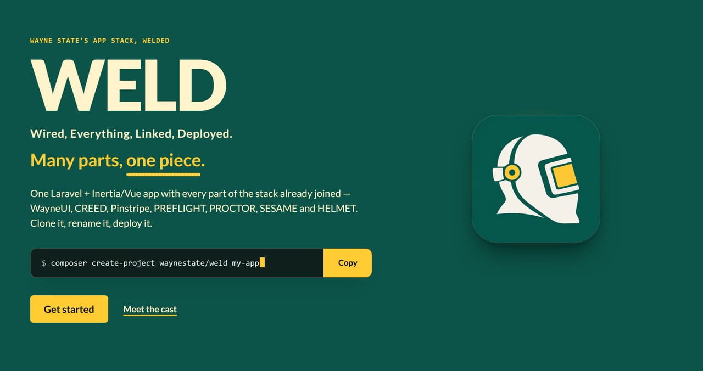
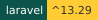
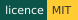
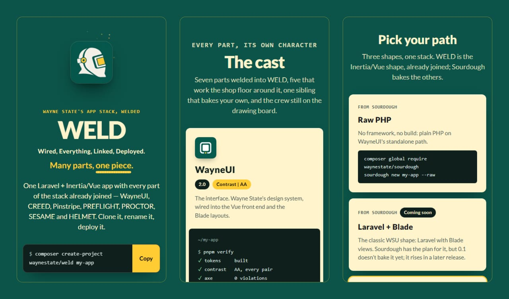

<p align="center">
  <a href="site/index.html"></a>
</p>

# WELD

<p>
  
  
  
  <a href="https://github.com/waynestate/weld/actions/workflows/ci.yml"></a>
</p>

**W**ired, **E**verything, **L**inked, **D**eployed. Many parts, one piece.

WELD is the whole Wayne State app stack joined into one application. Install it, deploy it, and every part is already
hooked up: sign-in, security headers, checks, coding standards, CI and the WayneUI interface. Think of it as the
Megazord, except it comes with a deploy script and nobody has to shout to make it combine.

## Get it

WELD is an app you start from, not a library you require — the Megazord ships in a repo, not a box.
Clone it and it is yours to rename:

```
git clone https://github.com/waynestate/weld.git my-app
cd my-app
composer install
npm ci
# Windows (PowerShell):
Copy-Item .env.example .env
# Linux/macOS:
cp .env.example .env
php artisan key:generate
```

## What is welded in

| Part | What it does in WELD |
|---|---|
| WayneUI | The interface: Wayne State's design system, wired into the Vue front end and Blade layouts |
| CREED | The written standards and `policy.json`: supported PHP, Laravel and Node versions |
| Pinstripe | The coding standard: Pint, PHPStan level 8, ESLint and Prettier |
| PREFLIGHT | The CI pipeline, from GitLab CI/CD components |
| PROCTOR | The checks, run in CI and as the deploy gate |
| SESAME | Sign-in, with CAS today and the auth gateway later, and app-native sessions |
| HELMET | The baseline runtime: security headers and CSP, sessions, trusted proxies, `/up` |

<p align="center">
  
</p>
<p align="center"><sub>One request, six stops, one seam. The bead runs the length of it; with reduced motion on, it stays put.</sub></p>

<details>
<summary><b>See the front page</b>: three cuts from <code>site/</code> at phone width</summary>
<br>
<p align="center"></p>
</details>

## Status

The Laravel base is in. The stack packages arrive once they are on Packagist, and each one gets welded on as it lands.
Until then, WELD runs on the starter kit plus these stack defaults:

- `composer.json` is `waynestate/weld`, requires PHP `^8.3`, and the lock file resolves for 8.3.0
- `.env.example` sets `APP_NAME=WELD`, `LOG_CHANNEL=stderr` and `SESSION_DRIVER=database`
- `Schema::defaultStringLength(191)` keeps index keys under Citadel's MySQL 5.6 767-byte cap
- `.gitattributes` sets `* text=auto eol=lf`
- `composer ci` is the CI contract: it runs validate, tests, Pint, PHPStan level 8 and audit, the same command on
  GitLab and GitHub
- `pint.json` and `phpstan.neon` copy Pinstripe's 0.1 Laravel presets (Pinstripe is not on Packagist yet); they
  switch to `includes: vendor/waynestate/pinstripe/...` once it lands
- The starter kit's password auth (register, login, password reset, two-factor) is removed on purpose; SESAME owns
  sign-in at `/login`, `/logout` and `/cas/*`, and `/login` answers 503 until SESAME is welded in
- The license is MIT

Best practices for building, running and deploying WELD live in [BEST_PRACTICES.md](BEST_PRACTICES.md).

## Run it locally

The same commands work on Windows, macOS and Linux.

1. `composer install`
2. Copy `.env.example` to `.env`
3. `php artisan key:generate`
4. `php artisan migrate`
5. `npm ci`
6. `npm run build`
7. `composer run dev`

Then open http://localhost:8000.

## WELD and Sourdough

Sourdough makes a new app in any of the stack's shapes: raw PHP, Laravel with Blade, Laravel with Inertia and Vue.
WELD is one of those shapes, Laravel with Inertia and Vue, with every part already joined and proved to work together.
Pick Sourdough when you want a starter you shape yourself. Pick WELD when you want the finished piece.

## The cast

<p align="center">
  <a href="https://github.com/waynestate/wayne-ui" title="WayneUI"><picture><source media="(prefers-color-scheme: dark)" srcset="docs/readme/cast/wayneui-dark.png"></picture></a>
  <a href="https://github.com/waynestate/creed" title="CREED"></a>
  <a href="https://github.com/waynestate/proctor" title="PROCTOR"></a>
  <a href="https://github.com/waynestate/sesame" title="SESAME"></a>
  <a href="https://github.com/waynestate/helmet" title="HELMET"></a>
  <a href="https://github.com/waynestate/sourdough" title="Sourdough"></a>
  <a href="https://github.com/waynestate/squire" title="SQUIRE"></a>
  <a href="https://github.com/waynestate/preflight" title="PREFLIGHT"></a>
  <a href="https://github.com/waynestate/pinstripe" title="Pinstripe"></a>
  <a href="https://github.com/waynestate/booster" title="BOOSTER"></a>
  <a href="https://github.com/waynestate/rollcall" title="ROLLCALL"></a>
  <a href="https://github.com/waynestate/drawbridge" title="DRAWBRIDGE"></a>
  <a href="https://github.com/waynestate/advisor" title="ADVISOR"></a>
  <a href="https://github.com/waynestate/weld" title="WELD"></a>
</p>

<p align="center"><sub>Fourteen parts, one bead. The README art is cut from the front page by
<a href="scripts/readme-art/README.md"><code>scripts/readme-art</code></a>; no sparks were drawn in its making.</sub></p>
