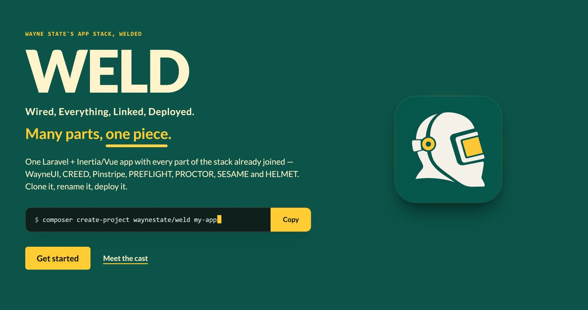
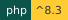
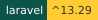

# Overview

This page orients you to WELD: what it is, which path to pick first, and where the project stands today.

**WELD**

  

**W**ired, **E**verything, **L**inked, **D**eployed. Many parts, one piece.

WELD is the whole Wayne State app stack joined into one application. Install it, deploy it, and every part is already
hooked up: sign-in, security headers, checks, coding standards, CI and the WayneUI interface. Think of it as the
Megazord, except it comes with a deploy script and nobody has to shout to make it combine. Fourteen parts, one bead.

## Pick your path

- [Quick start](guides/quick-start.md): bring the whole stack up with one Docker command.
- [Install](install.md): get a copy with composer create-project, or clone it if you want the history too.
- [What is welded in](guides/whats-welded-in.md): the parts and what each does in the app.
- [Running WELD off Citadel](running-off-citadel.md): OpenShift, Coolify and plain Docker, with Citadel for comparison.

## Status

Latest release: 0.1.2 (2026-11-03). The license is MIT.

**Not to be confused with:** `weld:doctor` checks local setup only; standards checks are PROCTOR's.

Agents: fetch [https://weld.apps.wayne.edu/llms.txt](https://weld.apps.wayne.edu/llms.txt).

## Related

- [Install](install.md)
- [Quick start](guides/quick-start.md)
- [What is welded in](guides/whats-welded-in.md)
- [Changelog](changelog.md)
